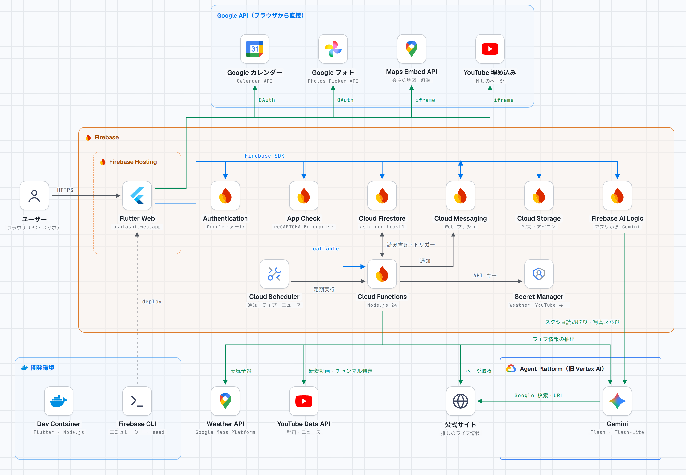

# おしあし

推し活（ライブ参戦・チケットの申込・入金期限・グッズ交換・遠征・思い出の記録など）を、ひとつにまとめて管理する Flutter Web アプリです。
DevFest GDGoC Japan Hackathon 2026 の提出作品です。

- 公開 URL: https://oshiashi.web.app
- 対応端末: PC・スマホのブラウザ（Flutter Web）



## 特長

1. **スクショ・公式サイトからの読み取り**：告知画像やチケットサイトのスクリーンショットから、Gemini で公演日時・会場・受付・申込期限・入金期限を取り出します。公式サイトからライブ情報を自動で集める機能もあります（Cloud Functions + Gemini）。
2. **共通データ**：だれかが登録したライブ情報は、同じ推しのユーザー全員で共有されます。既存のデータと照合して重複を防ぎ、日程変更などは変更履歴を残して更新します。
3. **自分のライブ一覧と締切**：一覧に入れたライブだけを対象に、次の締切と受付ごとの申込状況（未申込／申込済／当選／落選／入金済）を管理します。

## 主な機能

| 機能 | 内容 | 主なコード |
|---|---|---|
| ログイン | Google ログイン、メールアドレスでのログイン | `lib/features/auth/` |
| 推し | 推しの検索・フォロー・追加の申請（運営が承認して公開）。推しの色・絵文字・画像・記念日 | `lib/features/oshi/` |
| ライブ・受付 | 手入力での登録、既存データとの照合・更新・変更履歴、自分のライブ一覧、次の締切 | `lib/features/live*/` |
| スクショ読み取り | 画像から Gemini で情報を取り出し、確認・修正してから保存 | `lib/features/scan/` |
| ライブ情報の自動取得 | 推しの公式サイトを巡回し、ライブ・公演・受付を取り込む | `functions/live_fetch/` |
| Google カレンダー連携 | 公演日時・申込期限・入金期限をカレンダーに追加 | `lib/services/google_calendar_service.dart` |
| リマインド通知 | 申込開始・締切が近づいたら Web プッシュで通知（FCM） | `functions/index.js` |
| 推しのお知らせ | 推しの YouTube の新着をホームに表示 | `functions/oshi_news/` |
| グッズ交換 | 譲／求の投稿、相互マッチの自動提示、返信、個人チャット | `lib/features/goods/`・`lib/features/trade/` |
| メモリー | 参戦した公演の写真・座席・セトリ・感想をチケット風に記録。Google フォトからの取り込み、Gemini での写真えらび、SNS 投稿用画像の作成 | `lib/features/memory/`・`lib/features/photos/` |
| 遠征 | 交通・宿の予定、会場の地図、公演日の天気 | `lib/features/travel/` |
| 費用管理 | チケット・グッズ・遠征費の記録と推しごとの集計 | `lib/features/expense/` |

## 技術スタック

| 分類 | 採用技術 |
|---|---|
| フロントエンド | Flutter（stable）Web、Riverpod 3、go_router |
| 認証 | Firebase Authentication（Google ログイン・メールアドレス） |
| データベース | Cloud Firestore（`asia-northeast1`） |
| ファイル | Cloud Storage for Firebase |
| AI | Gemini（アプリからは Firebase AI Logic 経由、Functions からは Vertex AI 経由） |
| サーバー処理 | Cloud Functions for Firebase（Node.js 24） |
| 通知 | Firebase Cloud Messaging（Web プッシュ） |
| 外部 API | Google Calendar API、Google Photos Picker API、YouTube Data API、Maps Embed API、Weather API（Google Maps Platform） |
| 保護 | Firebase App Check（reCAPTCHA Enterprise） |
| 公開 | Firebase Hosting |

## フォルダ構成

```
lib/
  app.dart            ルート定義（go_router）
  main.dart           起動・Firebase の初期化
  features/<機能>/    画面
  models/             データモデル
  providers/          Riverpod のプロバイダ
  repositories/       Firestore・Auth などへのアクセス（画面からは直接呼ばない）
  services/           Gemini・Google カレンダー・Google フォトなど
  theme/  utils/      テーマ・共通の関数
test/                 Flutter のテスト（単体・ウィジェット）
test_rules/           Firestore セキュリティルールのテスト（エミュレータ）
functions/            Cloud Functions（通知・天気・ライブ情報の取得・推しのお知らせ）
demo_site/            デモ用の架空の公式サイト（ライブ情報の自動取得・スクショ読み取りのデモ）
tools/seed/           デモ用データの投入・削除スクリプト
markdown/             仕様書・データベース設計・機能ごとの実装計画・デプロイ手順
notes/                判断ログ・レビュー記録・進捗・構成図
firestore.rules  storage.rules  firestore.indexes.json
```

## 開発環境の準備

VS Code の Dev Container（`.devcontainer/`）で開発します。`flutter`・`firebase`・`flutterfire` のコマンドは、すべてコンテナ内で実行します。

```bash
flutter pub get
flutter run -d web-server --web-hostname 0.0.0.0 --web-port 8080
```

Mac のブラウザで http://localhost:8080 を開きます。パッケージを追加したときは、ホットリスタートではなく起動し直してください。

App Check・通知・地図のキーは、リポジトリに書かず `--dart-define`（または `--dart-define-from-file`）で渡します。キーが無くてもアプリは動きます（該当の機能だけが無効になります）。

```bash
flutter run -d web-server --web-hostname 0.0.0.0 --web-port 8080 \
  --dart-define-from-file=/root/prod_defines.json   # APP_CHECK_SITE_KEY・FCM_VAPID_KEY・MAPS_EMBED_KEY
```

## テストと静的解析

| 目的 | コマンド |
|---|---|
| 静的解析 | `flutter analyze` |
| テスト | `flutter test` |
| 整形 | `dart format lib test` |
| Firestore ルールのテスト | `firebase emulators:exec --only firestore --project demo-oshiashi "npm --prefix test_rules test"` |
| デモ用サイトのテスト | `npm --prefix demo_site test` |

## 公開（デプロイ）

ビルド・Firebase コンソールでの設定・公開後の確認は [`markdown/deploy_手順.md`](markdown/deploy_手順.md) にまとめています。デモ用データの入れ方は [`tools/seed/README.md`](tools/seed/README.md)、デモ用サイトは [`demo_site/README.md`](demo_site/README.md) を見てください。

## ドキュメント

| 資料 | 内容 |
|---|---|
| [`markdown/app_config.md`](markdown/app_config.md) | 仕様書（決定事項と未決定事項） |
| [`markdown/Database_config.md`](markdown/Database_config.md) | Firestore のデータ構造とセキュリティルールの方針 |
| `markdown/feature_*_plan.md` | 機能ごとの実装計画 |
| `notes/判断ログ_*.md` | 判断したこと（比べた案・選んだ理由・捨てた案） |
| `notes/*_レビュー記録.md` | レビューの記録 |
| [`CLAUDE.md`](CLAUDE.md) | AI（Claude Code）と開発するときの決まり |

## AI の使い方

- **アプリの中で**：Gemini でスクショからライブ情報を取り出す、公式サイトからライブ情報を集める、メモリーに使う写真を選ぶ。
- **開発で**：Claude Code を使い、仕様書・実装計画をもとに、データ層・画面・テスト・レビューの役割に分けたエージェントで実装しました。判断の経緯は `notes/` に残しています。

## 注意

- 登場するデモ用のグループ・人物・会場・ライブは、すべて架空です。
- ライブ情報の自動取得のデモ用に、架空の公式サイトを https://g-palette-demo.web.app に公開しています（ソースは `demo_site/`）。
- 推しの公式 YouTube には、動画の取得と再生を確認できるよう、実在の公開チャンネルを設定しています。
- API キーや秘密情報はコミットしません。`lib/firebase_options.dart` の Web 用設定は、公開される前提の値です。
